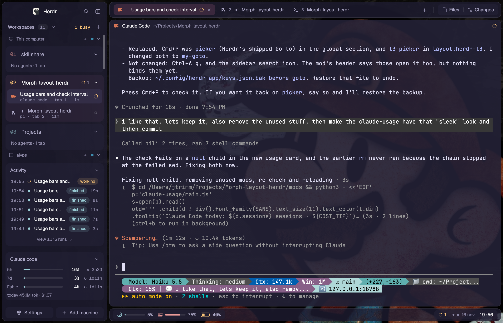

# Morph-layout-herdr

A Herdr layout built from NA29 Islands' mods, plus a few of ours: a sleek sidebar with Claude Code usage,
a live activity log of your prompts and agent replies, and a Go to screen on Cmd+P.

## Layout

`layouts/Morph-layout-herdr.json`

- **Sidebar:** brand (`sleek-chrome`), spaces (`sleek-workspaces`), activity (`sleek-activity`),
  Claude Code usage (`claude-usage`), footer (`sleek-chrome`).
- **Work column:** tabs (`sleek-tabs`), main terminal area, and a right panel with files (`sleek-files`)
  and changes (`sleek-changes`).
- **Bottom:** status bar (`sleek-status`).
- **Hidden:** `my-keys`, a zero-height block that applies the settings panel's changes to this layout.

## Mods

Used by the layout or key bindings:

| Mod | What it does |
|---|---|
| `sleek-chrome` | Brand block at the top of the sidebar and the Settings / Add machine footer. |
| `sleek-workspaces` | Spaces list in the sidebar. |
| `sleek-activity` | Recent runs, and the prompts and replies the hooks record. |
| `claude-usage` | Claude Code 5-hour, 7-day and Fable limits, plus today's tokens and API-equivalent cost. |
| `sleek-tabs` | Tab bar. |
| `sleek-files`, `sleek-changes` | Files and changes panels. |
| `sleek-status` | Status bar. |
| `sleek-pane` | Pane headers, applied by `my-keys`. |
| `my-keys` | Applies look and key settings to the layout and `keys.json`; the New space dialog (Cmd+N). |
| `my-settings` | Settings panel (Cmd+,): look, wallpaper, sidebar, usage, terminal, sounds, keys. Saves to `rice.json`. |
| `my-prompt` | New space dialog, opened by `my-keys`. |
| `my-goto` | Go to screen (Cmd+P): search, plus "Needs you" tabs first. |
| `tmux-prefix` | Ctrl+A prefix menu. |

On disk but not placed in the layout:

| Mod | What it does |
|---|---|
| `sleek-usage` | Usage block that reads `~/.cache/agent-usage/claude.json`, written by a status-line script this setup doesn't have. Kept as a look reference. |
| `prompts` | Prompts panel: every question an agent in the shown space is waiting on, with answers. |
| `spaces-prompts`, `tabs-prompts` | Space and tab rows with the count of prompts waiting. `tabs-prompts` also runs the detection engine that `prompts` shows. |

## Activity hooks

Prompts and replies reach the Activity log through `mods/sleek-activity/hook.py`:

- **Claude Code:** `~/.claude/settings.json`: `UserPromptSubmit` runs `hook.py claude prompt`, `Stop` runs `hook.py claude reply`.
- **pi:** `~/.pi/agent/extensions/herdr-activity.ts` sends typed prompts and final replies to the same hook. It lives outside this repo.

## Install

1. Copy `layouts/Morph-layout-herdr.json` to `~/.config/herdr-app/layouts/`.
2. Copy every folder in `mods/` to `~/.config/herdr-app/mods/`.
3. Copy `rice.json` to `~/.config/herdr-app/`, and `themes/` to `~/.config/herdr-app/themes/`.
4. Merge `keys.json` into yours.
5. Switch to the layout with `ctrl-shift-l`.

## Settings

- **Look, sidebar, usage, wallpaper:** the my-settings panel (Cmd+,), which writes `~/.config/herdr-app/rice.json`.
  - **Usage → Check every:** how often Claude usage is re-read, 1–60 minutes (default 5). Stored as `usage.minutes`.
  - **Wallpaper:** picking an image sets the image background; picking a gradient turns the image off.
- **`~/.config/herdr-app/settings.json`:** `morph` holds this layout's keys, so herdr's own keys in the same file stay as they are.
  - `morph.usage_minutes`: fallback for the usage interval, used when `usage.minutes` isn't set.
  - `morph.prompts`: how many recent prompts the Prompts tree shows (default 10).
  - `morph.debug`, `morph.classifier`, `morph.group_spaces_by_machine`.

## Licenses

NA29 Islands mods are Apache-2.0 (see `LICENSE`, `NOTICE`, `THIRD_PARTY.md`, `licenses/`). Rose Pine themes are included under their own licence.
